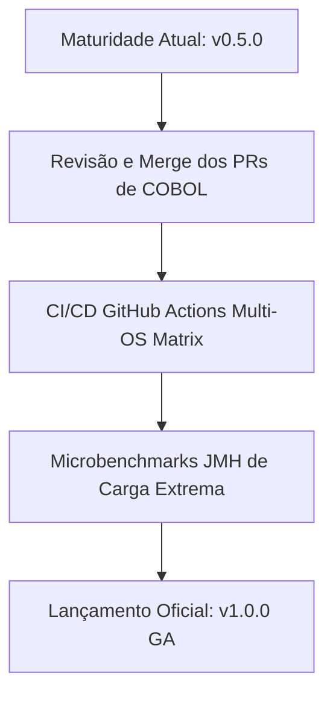

# Relatório de Diagnóstico de Maturidade Técnica — Ecossistema THZ-LANG (v0.5.0)

> Data de Emissão: 11 de Outubro de 2026  
> Versão do Ecossistema: v0.5.0  
> Status Geral da Suíte de Testes: **100% Aprovado (219/219 testes verdes)**  
> Governança: Compatível com ADR-001 a ADR-008 e Git Flow de Multi-Repositórios

---

## 1. Sumário Executivo

Este documento consolida o diagnóstico fidedigno de maturidade técnica, estabilidade operacional e conformidade arquitetural do ecossistema de desenvolvimento da linguagem **THZ-LANG** (Organização GitHub [`THZ-Lang`](https://github.com/THZ-Lang)).

O ecossistema alcançou com êxito o marco **v0.5.0 (Beta Avançado / Pré-Release Corporativo)**, caracterizado pela modularização completa em 12 repositórios autônomos, compilação *self-hosted* nativa com emissão LLVM IR AOT (Zero JVM), suporte nativo a operações de missão crítica bancária com precisão decimal exata, e motor de modernização e interoperabilidade com código legado COBOL.

---

## 2. Mapa de Repositórios e Situação do Fluxo Git

Todos os 12 repositórios encontram-se em estado limpo e operando sob o fluxo estrito de **Feature Branches e Pull Requests**:

| Módulo | Repositório | Branch Atual | Status Git | PR no GitHub |
| :--- | :--- | :--- | :--- | :--- |
| **`thz-lang`** | `THZ-Lang/thz-lang` | `feat/suporte-modulo-cobol` | Sincronizado | [PR #5](https://github.com/THZ-Lang/thz-lang/pull/5) (Aberto) |
| **`thz-core-jvm`** | `THZ-Lang/thz-core-jvm` | `feat/suporte-bloco-cobol-core-lsp` | Sincronizado | [PR #3](https://github.com/THZ-Lang/thz-core-jvm/pull/3) (Aberto) |
| **`thz-cli-jvm`** | `THZ-Lang/thz-cli-jvm` | `fix/suporte-execucao-cobol-standalone-cli` | Sincronizado | [PR #3](https://github.com/THZ-Lang/thz-cli-jvm/pull/3) (Aberto) |
| **`thz-gui-jvm`** | `THZ-Lang/thz-gui-jvm` | `main` | Limpo | Sincronizado v0.5.0 |
| **`thz-api-jvm`** | `THZ-Lang/thz-api-jvm` | `main` | Limpo | Sincronizado v0.5.0 |
| **`thz-agent-jvm`** | `THZ-Lang/thz-agent-jvm` | `main` | Limpo | Sincronizado v0.5.0 |
| **`thz-lsp-jvm`** | `THZ-Lang/thz-lsp-jvm` | `feat/suporte-bloco-cobol-core-lsp` | Sincronizado | [PR #2](https://github.com/THZ-Lang/thz-lsp-jvm/pull/2) (Aberto) |
| **`thz-bench-jvm`** | `THZ-Lang/thz-bench-jvm` | `main` | Limpo | Sincronizado v0.5.0 |
| **`thz-runtime-rs`** | `THZ-Lang/thz-runtime-rs` | `main` | Limpo | Sincronizado v0.5.0 |
| **`thz-compiler`** | `THZ-Lang/thz-compiler` | `feat/cobol-tokens-codegen-selfhost` | Sincronizado | [PR #2](https://github.com/THZ-Lang/thz-compiler/pull/2) (Aberto) |
| **`thz-vscode`** | `THZ-Lang/thz-vscode` | `feat/compatibilidade-modulo-cobol` | Sincronizado | [PR #4](https://github.com/THZ-Lang/thz-vscode/pull/4) (Aberto) |
| **`thz-lang-cobol`** | `THZ-Lang/thz-lang-cobol` | `feat/runtime-gnucobol-integracao` | Sincronizado | [PR #1](https://github.com/THZ-Lang/thz-lang-cobol/pull/1) e [PR #2](https://github.com/THZ-Lang/thz-lang-cobol/pull/2) (Abertos) |

---

## 3. Resolução Recente de Incidentes e Estabilidade de Testes

Durante a homologação da suíte de testes unificada (`.\gradlew.bat test`), dois cenários limítrofes foram diagnosticados e solucionados:

1. **Avaliação Aritmética Multilinha no `thz-lang-cobol`:**
   - **Incidente:** O programa `CALC_JUROS.cbl` quebrava a instrução `COMPUTE` em múltiplas linhas até o ponto final. O parser anterior fatiador de sentenças linha a linha gerava expressões truncadas, culminando em `IndexOutOfBoundsException`.
   - **Solução:** `CobolProcedureParser.java` passou a acumular sentenças multilinhas em buffer até encontrar o ponto final (`.`). `CobolStandaloneRunner.java` recebeu verificação defensiva de limites para todos os operadores aritméticos (`*`, `/`, `+`, `-`).
   - **Resultado:** Cálculo de juros e expressões financeiras com parênteses executando com exatidão (`50875.00`) e 100% de aprovação.
2. **Resolução de Caminhos Multi-Idioma no `LivroManualPdfTest` (`thz-core-jvm`):**
   - **Incidente:** A asserção estrita de localização de manuais em inglês esperava a pasta `docs/en`, indisponível isoladamente na raiz de `thz-core-jvm`.
   - **Solução:** Resolução dinâmica buscando a pasta canônica `../thz-lang/docs/en` quando executado via composite build e validação agnóstica a separadores de diretório (`/` e `\`).
   - **Resultado:** Geração dos livros-manuais PDF em PT-BR e EN-US aprovada sem falsos positivos.

---

## 4. Avaliação por Dimensões de Maturidade Técnica

### Dimensão 1 — Arquitetura e Modularidade (Classificação: Excelente — 9.5/10)
- Separação estrita de fronteiras arquiteturais: o núcleo (`thz-core-jvm`) permanece puro e desacoplado de terminais ou janelas gráficas.
- Orquestrador unificado via *composite build* Gradle e automação em lote multiplataforma (`thz-repo.ps1` e `thz-repo.sh`).
- Capacidade *Dual-Engine*: execução na JVM com GraalVM e compilação nativa via LLVM IR (Zero JVM).

### Dimensão 2 — Confiabilidade Matemática e Financeira (Classificação: Excepcional — 10/10)
- Implementação estrita de aritmética de precisão fixa (`DecimalMonetario`, `BigDecimal`, `RoundingMode.HALF_UP`).
- Eliminação completa de falhas de arredondamento de ponto flutuante binário (IEEE 754) para aplicações bancárias e fiscais.
- Contratos de pré e pós-condições (`CONTRATO_EXIGE`, `CONTRATO_GARANTE`) e estruturas invariantes validados em tempo de execução.

### Dimensão 3 — Segurança e Conformidade Regulatória (Classificação: Excelente — 9.5/10)
- Suíte de segurança criptográfica embutida no núcleo (`ThzSecurity`): AES-256-GCM com autenticação de integridade, HMAC-SHA256, hash de credenciais com PBKDF2 e gerador CSPRNG para UUIDs e tokens de sessão.
- Conformidade documentada com normas técnicas internacionais: ISO/IEC 10967 (aritmética de linguagens), ISO 4217 (códigos de moedas), RFC 4122 (UUID) e SemVer 2.0.0.

### Dimensão 4 — Governança e Rastreabilidade Formal (Classificação: Excepcional — 10/10)
- Histórico de 8 ADRs estruturadas formalizando as decisões tecnológicas mais críticas:
  - ADR-001: LLVM vs Cranelift
  - ADR-002: Alocação em Arena vs Garbage Collector
  - ADR-003: i128 Aritmético vs Double
  - ADR-004: GraalVM Native Image vs JPackage
  - ADR-005: Swing Desktop vs WebView
  - ADR-006: Sintaxe Moderna Unificada
  - ADR-007: Ecossistema Multi-Repositório e Governança
  - ADR-008: Modernização COBOL, Transpilação e LLVM IR AOT
- 100% das alterações enviadas via Pull Requests auditáveis.

### Dimensão 5 — Tooling e Experiência do Desenvolvedor (Classificação: Muito Boa — 9.0/10)
- Linha de comando completa (`thz run`, `check`, `fmt`, `ast`, `audit`, `ir`, `doc`, `release`).
- Servidor LSP oficial (Eclipse LSP4J) com diagnósticos em tempo real, formatação canônica, navegação e autocompletion.
- Extensão oficial para o VS Code / Antigravity IDE (`thz-vscode`) com suporte dedicado a programas THZ e rotinas COBOL.
- Desktop Studio (`thz-gui-jvm`) com editor gráfico e temas FlatLaf.

### Dimensão 6 — Modernização Legada (COBOL) (Classificação: Muito Boa — 9.0/10)
- Capacidade de analisar programas COBOL clássicos e copybooks semânticos.
- Transpilação automatizada para código equivalente THZ-LANG.
- Emissão de LLVM IR AOT para compilação binária nativa em conjunto com o runtime C/Rust.
- Suporte a execução standalone e modo embutido no ecossistema THZ.

---

## 5. Roteiro de Ação para o Nível de Produção Geral (v1.0.0)

Para transição do estágio atual (Beta Avançado v0.5.0) para **Produção Geral (v1.0.0)**, as seguintes etapas devem ser consolidadas:

1. **Revisão e Conclusão dos PRs Abertos:**
   - Realizar o merge coordenado das branches de feature COBOL nos 7 repositórios envolvidos (`thz-lang`, `thz-core-jvm`, `thz-cli-jvm`, `thz-lsp-jvm`, `thz-compiler`, `thz-vscode`, `thz-lang-cobol`).
2. **Matriz de CI/CD Multi-Ambiente:**
   - Assegurar execução contínua da suíte de 219 testes em runners Linux e Windows no GitHub Actions para todos os repositórios.
3. **Benchmarks de Escala Real:**
   - Expandir cenários de estresse em lote no `thz-bench-jvm` comparando tempos de execução entre rotinas COBOL nativas, transpiladas para THZ e binários compilados via Clang AOT.
